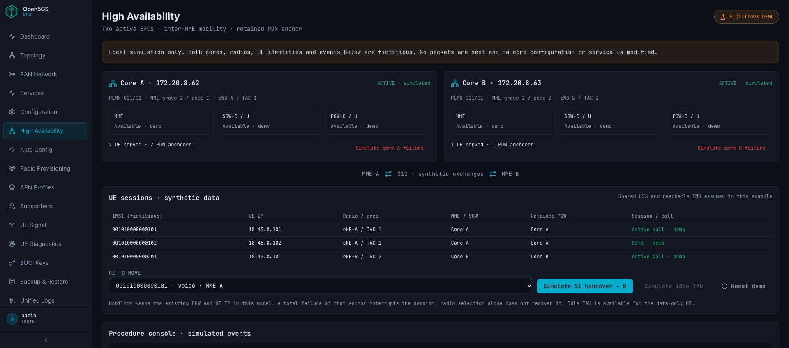

# High Availability demonstration

Open **High Availability** in the desktop sidebar or mobile navigation.

This module is a local, fictitious illustration of two active EPCs with distinct radio tracking areas. All cores, radios, UE identities, sessions and events on this page are synthetic. It does not configure a real HA deployment or send core protocol traffic.

Choose a UE and simulate S1 handover to the other core. The example preserves its original PGW anchor and UE IP. Idle TAU is available for the data-only UE. Simulating core failure marks sessions using that MME or PGW as interrupted; it does not claim seamless recovery. **Reset demo** restores the initial scenario. Navigating away also discards the local simulation state.

The procedure console illustrates EPS mobility, not a protocol emulator or 3GPP conformance test. Multi-MME S1-flex radio configuration is outside this demonstration.

